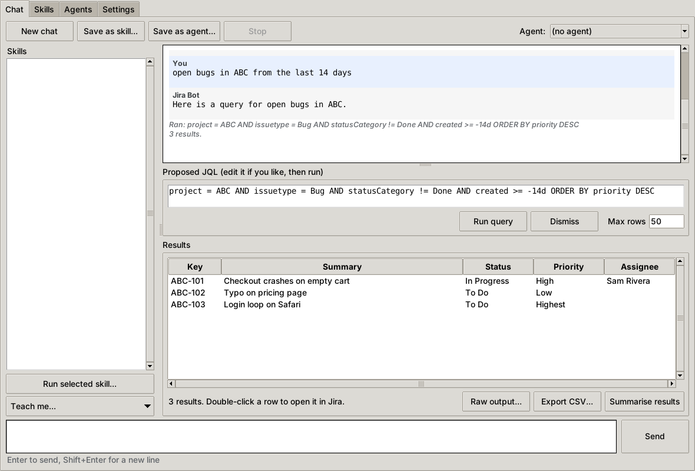
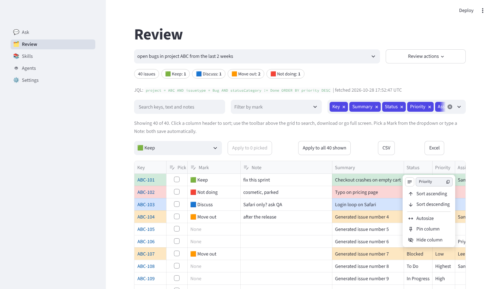
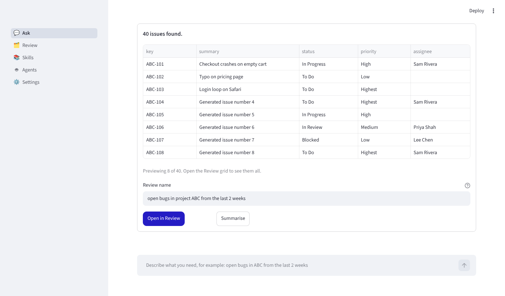

# Jira Bot

Ask Jira questions in plain English. Jira Bot uses **GitHub Copilot CLI** to turn what you ask into JQL, the **Atlassian CLI (ACLI)** to run it, and it **learns from you**: whatever works can be saved as a reusable *skill*, and skills can be bundled into an *agent*.

It comes in two front-ends that share the same core, skills and agents:

| | Web edition (recommended for big result sets) | Desktop edition |
|---|---|---|
| Start with | `./run-web.sh` or `run-web.bat` | `python app.py` or `run.bat` / `run.sh` |
| Built with | Streamlit (installs into a private `.venv`) | Tkinter, standard library only |
| Results | Excel-like **Review grid**: sort, hide columns, search, colour marks, notes that are saved | Simple results table, CSV export |

Everything runs on your machine. There is no hosted service and no Jira REST code.

```
You type a question
      |
      v
Copilot CLI  ->  proposes a JQL query (asks you questions first if it needs to)
      |
      v
You review the JQL, edit it if you like, press Run
      |
      v
ACLI runs the query in Jira  ->  results table, summary, CSV export
      |
      v
Save what worked as a skill or agent  ->  files in skills/ and agents/
```



On a fresh install it starts from a blank slate and offers ways to teach it: [screenshot](docs/screenshots/blank-state.png).

## What you can do

- **Chat**: describe what you want ("open bugs in ABC from the last 2 weeks"). The bot asks short clarifying questions, shows you the JQL, and only runs it when you press **Run query**.
- **Start from a blank slate**: a fresh install knows nothing about your Jira. It says so, and offers three ways to teach it (below).
- **Skills**: saved, reusable JQL recipes with parameters (for example `project` and `days`). The bot lists them when you start, suggests one when it fits, and you can run any of them with a form.
- **Agents**: a saved persona with instructions ("group by priority, call out unassigned"), the skills it should use, and defaults such as your project key.
- **Import a skill document**: upload a file, or type its path, and the bot turns it into skills for you to review.
- **Results**: a table (double-click a row to open the issue in Jira), a **Summarise results** button, CSV export.

## Requirements

- Python 3.9 or newer **with Tkinter** for the desktop edition (the web edition needs Python 3.10 or newer and does not need Tkinter). The Windows and macOS installers from python.org include it. On Ubuntu or Debian: `sudo apt install python3-tk`.
- **GitHub Copilot CLI** (`copilot`), installed and signed in. Your company's setup instructions apply.
- **Atlassian CLI** (`acli`), installed. Jira login is done from the app (Settings tab) or in a terminal.
- A Jira Cloud API token for your Atlassian account (Atlassian account settings, Security, API tokens).

## Quick start

```
git clone <your-repo-url>
cd jira-bot
python app.py
```

On Windows you can also double-click `run.bat`. On macOS or Linux run `./run.sh`.

For the web edition run `./run-web.sh` (or `run-web.bat`) instead; see [Web edition](#web-edition-the-review-grid).

### First run (about two minutes)

1. Open the **Settings** tab.
2. (Or skip this page: put the values in a `.env` file, see [Configuring with a .env file](#configuring-with-a-env-file).) Enter your Jira **site** (for example `mycompany.atlassian.net`), your **email**, and your **API token**, then press **Log in to Jira**. The token is passed to ACLI once and is **never saved by this app**.
3. Press **Check login**. It shows ACLI's login status and runs one tiny test search.
4. Press **Test Copilot**. If it prints a short reply, the bot can talk to Copilot.
5. Go back to the **Chat** tab and ask something.

If either test fails, see [Troubleshooting](#troubleshooting). The Settings tab lets you change both commands and the Copilot model.

## Web edition: the Review grid

Start it with `./run-web.sh` (macOS, Linux) or `run-web.bat` (Windows). The first run creates a private `.venv` and installs `requirements-web.txt` (Streamlit and openpyxl; needs Python 3.10 or newer). Your browser opens at <http://localhost:8501>. Press Ctrl+C in the terminal to stop it. Settings, skills and agents are the same files the desktop edition uses.



**The flow.** Ask in plain English on the **Ask** page, check the JQL, run it (tick *Fetch every page* when you expect hundreds or thousands of issues), then press **Open in Review**. Every other page is the same as the desktop tabs: **Skills** (list, edit, upload or point to documents, examples), **Agents**, **Settings** (Jira login, Test Copilot, Check login).



**In the Review grid you can:**

- **Sort** by clicking a column header. The column menu also has *Autosize*, *Pin column* and *Hide column*.
- **Hide or show columns** with the column picker above the grid. That choice is remembered for the review.
- **Search** keys, text and notes, and **filter by mark** (including "no mark").
- **Mark** an issue by choosing from the *Mark* dropdown, for example Keep, Discuss, **Move out**, **Not doing**. Marked rows are tinted in the mark's colour.
- **Write a note** in the *Note* column. Marks and notes **save the moment you change them**, so you can run a meeting without ever pressing Save.
- **Mark many at once**: tick *Pick* on several rows and press *Apply to N picked*, or apply a mark to everything currently shown (after filtering).
- **Rename marks and change their colours** under *Marks and colours*. Add your own (for example "Needs spec").
- **Export** what you see: *CSV*, or *Excel*, which keeps the colour tint, a frozen header row and filters.
- **Refresh from Jira** (Review actions) re-runs the review's query and **keeps your marks and notes**, matched by issue key. Issues that dropped out of the query are no longer listed, and their notes return if they come back.

Reviews are stored in a local SQLite file, `data/reviews.sqlite3`, which is git-ignored because it contains issue data and your comments. Each review is independent, and you can keep as many as you like (one per meeting or sprint). Deleting a review deletes its notes.

**Good to know**

- The grid handles thousands of rows comfortably (a 20,000-row review was tested for storage speed; scrolling is done by the browser grid). If your query returns more than your *Max rows* setting and you did not tick *Fetch every page*, you only get the first Max rows.
- Streamlit styles only the read-only cells, so the row tint covers the Jira columns while the *Pick*, *Mark* and *Note* cells keep a plain background. The mark's colour square is always shown in the *Mark* cell.
- While Copilot or ACLI is running there is no Stop button in the web edition (use the desktop edition if you need one); the commands end on their own at the timeouts in Settings.
- **Sharing a meeting.** By default the server listens only on this computer (`127.0.0.1`), which is the safe choice: screen-share the browser to your team. If you really want teammates to open it on their own machines, run `./run-web.sh --server.address 0.0.0.0`. There is **no login**, so anyone who can reach that port can read your results and use your Jira login through ACLI. Only do this on a network you trust, and prefer a VPN or SSH tunnel. Several people can then annotate the same review; edits are saved per issue, and the last edit to a cell wins. A teammate's change shows on your screen after your next interaction or page refresh.
- Streamlit sends no usage statistics from this app (`.streamlit/config.toml` turns them off).

## Configuring with a `.env` file

Instead of using the Settings page you can put your settings, and optionally your Jira API token, in a `.env` file next to `app.py`:

```
cp .env.example .env       # then edit .env (Windows: copy .env.example .env)
```

`.env` is git-ignored, so it is never committed. `.env.example` lists every variable:

| Variable | Meaning |
|---|---|
| `JIRABOT_JIRA_SITE`, `JIRABOT_JIRA_EMAIL` | Your Jira site and email |
| `JIRABOT_JIRA_API_TOKEN` (or `JIRA_API_TOKEN`) | Your API token, used only by the **Log in** button |
| `JIRABOT_COPILOT_COMMAND`, `_MODEL`, `_EXTRA_ARGS`, `_TIMEOUT` | Copilot CLI settings (`JIRABOT_COPILOT_MODEL` is the `--model` value) |
| `JIRABOT_ACLI_COMMAND`, `JIRABOT_ACLI_TIMEOUT` | Atlassian CLI settings |
| `JIRABOT_MAX_PROMPT_CHARS`, `JIRABOT_DEFAULT_LIMIT`, `JIRABOT_DEFAULT_FIELDS`, `JIRABOT_SHARE_RESULTS` | Limits and defaults |

How it behaves:

- **Order of precedence:** real environment variables, then `.env`, then settings saved in the app, then built-in defaults. Empty values in `.env` are ignored.
- **The token is still not stored by the app.** It is read into memory, sent to ACLI on stdin when you press **Log in** (leave the token box empty), and never written to `config.local.json` or the log. It does sit in plain text in your `.env`, so keep that file private. ACLI then keeps its own login, so you only need to log in once.
- Settings that come from `.env` are not copied into `config.local.json`; the web Settings page lists which ones are locked that way.
- Restart the app after editing `.env`.

## Teaching the bot: three ways to build skills

A skill is one reusable JQL recipe. Nothing is saved until you review it and press **Save skill**.

### 1. Save a good chat session

Work out a query in the Chat tab. The bot asks what it needs, proposes JQL, you run it. Then press **Save as skill...** (or type `save this as a skill called bug-triage-weekly`). Copilot drafts the skill from the conversation: it replaces values that change between runs (project key, number of days) with `{placeholders}`, and records your triage tips. You edit and approve it.

**Save as agent...** works the same way and drafts instructions, a skill list and defaults from the conversation.

### 2. Import a skill document (upload a file or give a file path)

Use **Skills > Import document...**, or **Teach me... > Import skill document...** in the Chat tab.

- Type or paste a **file path** (the quoted form from Windows "Copy as path" works), or press **Browse...** to pick one or **several** files.
- Or **paste the document text** into the box.
- Press **Import**. Each skill found is opened in an editor so you can review it. Save it, or **Skip this one**.

What counts as a skill document:

| File | What happens |
|---|---|
| `.md`, `.txt` and similar free-form notes (a playbook, a runbook, a saved list of queries) | Copilot reads it and writes one skill per reusable query, adding `{placeholders}` and your triage tips. |
| `.docx` (Word) | The text is extracted (paragraphs and tables), then handled like free-form notes. |
| A ready-made skill file (see [Skill files](#skill-files)) | Read directly. **No Copilot call is made.** |
| `.json` with `name` and `jql` fields | Read directly. |
| `.jql`, `.csv`, `.yaml` | Treated as text. |

PDF and old `.doc` files are not supported (the app tells you to save as `.docx` or `.txt`). Files over 5 MB are refused.

Things worth knowing:

- The document text is **sent to Copilot** to be converted. Untick *Use Copilot to turn the document into skills* in the import dialog to use simple extraction only (it picks JQL-looking text out of the document, and you fill in the rest).
- Very long documents are cut to the first part before being sent; the app tells you when that happens.
- If Copilot is unavailable, the app falls back to simple extraction and says so.
- The document is treated as data. The prompt tells Copilot not to follow instructions written inside it, and nothing runs until you review the skill and later press Run on a query.

Try the samples in `docs/examples/`: `triage-playbook.md` (free-form), `weekly-bug-triage.skill.md` (ready-made), `skills-sample.json`.

### 3. Browse example JQL patterns

**Skills > Examples...** shows starting points (open bugs, stale items, current sprint, blocked work, release scope and more). Pick one, adjust it in the editor, save it.

## Using skills

- On startup the Chat tab lists your skills. With none saved, it explains the blank slate instead.
- **Double-click a skill** (left panel) to run it. A small form asks for its parameters (prefilled with defaults), then the JQL appears for you to review and run.
- When you describe a need in plain English, the bot sees your skill names and descriptions and suggests a matching one.
- Pick an **Agent** (top right) to apply its instructions and defaults. If the agent lists skills, only those are offered.

## Skill files

Skills are Markdown files in `skills/`, one per skill. You can write them by hand.

```markdown
---
name: weekly-bug-triage
description: Open bugs for a project from the last few days, highest priority first
fields: key,summary,status,priority,assignee
limit: 50
parameters:
  - project | Jira project key | ABC
  - days | Look-back window in days | 7
---

## JQL

project = {project} AND issuetype = Bug AND statusCategory != Done AND created >= -{days}d ORDER BY priority DESC

## Output

Group by priority. Call out bugs with no assignee.

## Notes

Anything worth remembering.
```

- `name`: lowercase letters, digits, `-` and `_` (up to 64 characters). It is also the file name.
- `parameters`: one per line, `name | description | default`. Every `{placeholder}` in the JQL is declared automatically if you forget.
- `fields` and `limit` are optional. `Output` and `Notes` are optional free text.

## Agent files

Agents are Markdown files in `agents/`.

```markdown
---
name: triage-assistant
description: Weekly bug triage helper for my project
skills: weekly-bug-triage
defaults:
  - project | ABC
---

## Instructions

Group results by priority, then by assignee. Call out anything with no owner.
Finish with the two or three actions I should take today.
```

## What Jira Bot runs, exactly

These are the only commands the app issues, so you can check them against your installed versions.

```
copilot -p "<prompt>" [--model <model>] [your extra arguments]

acli jira auth status
acli jira auth login --site <site> --email <email> --token        (token sent on stdin)
acli jira workitem search --jql "<jql>" --json --limit <n> [--fields a,b,c]
acli jira workitem search --jql "<jql>" --json --paginate [--fields a,b,c]   (web edition, "Fetch every page")
```

If your ACLI does not accept `--json`, the app retries with `--csv`. If it does not accept `--paginate`, the app retries with `--limit`.

Arguments are always passed as a list, never through a shell, so text from the model cannot inject commands.

## Safety and privacy

- **Read-only.** The app only searches Jira. It never creates, edits or deletes work items.
- **You approve every query.** The JQL is shown in an editable box and runs only when you press **Run query**.
- **Copilot gets no tools.** It is called with `-p` and without any allow-tools flags, so it can only return text.
- **Your token is not stored.** It goes to ACLI on stdin. `config.local.json` holds only the settings you see in the Settings tab.
- **What is sent to Copilot:** the built-in instructions; the names, descriptions and parameters of your saved skills; the active agent's instructions; your messages and the bot's replies; the text of any document you import with Copilot; and, if **Send the first rows of query results to Copilot** is ticked in Settings (default on), up to 25 result rows (key, summary, status and so on) so follow-up questions and summaries work. Untick it to keep issue data away from Copilot; **Summarise results** then asks for one-time permission.
- **Logs.** `jirabot.log` records timings and errors only, not prompts or replies. Setting the environment variable `JIRABOT_DEBUG=1` logs full prompts and replies for troubleshooting; unset it afterwards.
- **Your skills and agents are git-ignored by default**, because JQL and project keys can be company data. To share skills with your team through git, delete the last four lines of `.gitignore`. Review skills before you push them.

## Troubleshooting

| Symptom | What to do |
|---|---|
| "Could not find 'copilot'" or "'acli'" | The program is not on your PATH. In Settings enter its full path, then use the Test buttons. |
| **Test Copilot** fails or hangs | Run `copilot -p "say hello"` in a terminal. If that works there but not in the app, send me the Settings screen and the output. The Settings tab has *Model* and *Extra arguments* boxes if your Copilot needs flags such as `--model` or a flag to silence extra output. |
| Windows: "is a Windows .cmd launcher, which cannot safely receive text..." | npm installs `copilot.cmd`, and `cmd.exe` cannot pass multi-line text safely. The app normally finds the Node script behind the launcher and calls Node directly. If it cannot, set the Copilot command in Settings to `node C:\path\to\npm-loader.js` (the script your `copilot.cmd` file runs), or to the real `copilot.exe`. |
| "Login failed" in Settings | Log in from a terminal instead, using the login options your ACLI version documents (`acli jira auth login --help` lists them), then press **Check login**. The app only needs ACLI to be logged in; it does not have to be the one that logs in. |
| "Unbounded JQL queries are not allowed" | Jira Cloud wants at least one restriction. Add a project, a date range or an assignee to the JQL. |
| Long chats fail on Windows | Command lines have a size limit. Lower **Max prompt size** in Settings (try 12000), or press **New chat**. |
| A reply is shown as plain text with a note about the format | Copilot ignored the reply format. Ask again, or try another model in Settings. |
| The table is empty but ACLI printed something | Press **Raw output...** to see exactly what ACLI returned. The app reads JSON, and CSV as a fallback. |
| Something else | Look at `jirabot.log` next to `app.py`. |

## Project layout

```
app.py                    start the desktop app (Tkinter)
web_app.py                start the web app (Streamlit)
run.bat / run.sh          desktop launchers
run-web.bat / run-web.sh  web launchers (create .venv on first run)
requirements-web.txt      packages for the web edition
.streamlit/config.toml    web server settings (local only, no telemetry)
jirabot/
  config.py               settings (config.local.json, .env, environment)
  envfile.py              tiny .env reader
  proc.py                 safe subprocess runner, Windows launcher handling
  llm.py                  Copilot CLI wrapper
  jira.py                 ACLI wrapper and output parsing
  prompts.py              prompt templates and size budgeting
  protocol.py             reads Copilot's tagged replies
  store.py                skill and agent files
  importer.py             reads skill documents (md, txt, json, docx, ...)
  skillgen.py             skills from chats and documents, with fallbacks
  examples.py             example JQL patterns
  session.py              conversation state
  reviews.py              review store (SQLite): snapshots, marks, notes
  export.py               CSV and Excel export of a review
  ui/                     Tkinter tabs and dialogs
  web/                    Streamlit pages (ask, review, skills, agents, settings) and grid helpers
skills/  agents/          your saved skills and agents (git-ignored)
data/                     your reviews, marks and notes (git-ignored, created on first use)
docs/examples/            sample documents to import
tests/                    unit tests, fake copilot and acli, GUI tests
```

## Development and tests

```
python -m unittest discover -s tests            # unit tests (use stand-in copilot and acli scripts)

# Web-edition tests need the web packages, so use the .venv that run-web.sh creates:
.venv/bin/python tests/test_grid.py            # (Windows: .venv\Scripts\python tests\test_grid.py)
.venv/bin/python tests/test_reviews.py

# GUI tests need a display. On Linux, with a virtual one:
xvfb-run -a -s "-screen 0 1400x900x24" python tests/gui_smoke.py
xvfb-run -a -s "-screen 0 1400x900x24" python tests/gui_mainloop.py
```

The tests use scripts in `tests/fakes/` that imitate `copilot -p` and `acli`, so they need no network, no Jira and no Copilot.

**What has and has not been verified.** The app, its file handling, the document import, the Windows launcher handling and the full chat, run, save and import flows were tested against those stand-ins. The web edition was also driven in a real headless Chromium (Streamlit 1.66.1, Linux): asking, running, opening a review, choosing marks, typing notes, sorting and then editing (the edit lands on the right issue), bulk marking, filtering, hiding columns, CSV and Excel downloads, and restarting the server to confirm the marks and notes persisted. It has not been tried on Windows or macOS, or in Safari or Firefox. They were **not** run against a real Copilot CLI or a real Jira site, and flag names in both CLIs change between versions. Your first run is therefore the real test: use **Test Copilot** and **Check login** in Settings, and if a flag differs on your versions, the commands in "What Jira Bot runs, exactly" are the single place to compare against `copilot --help` and `acli jira workitem search --help`.

## Limits

- One question at a time; the app does not stream Copilot's answer, it shows it when complete.
- Results are capped by **Max rows** (default 50) per query. In the web edition, *Fetch every page* removes the cap.
- Jira Cloud only (ACLI's Jira support).
- Skills and agents are plain files; there is no sync between machines other than git (see the `.gitignore` note) or copying the folders.
